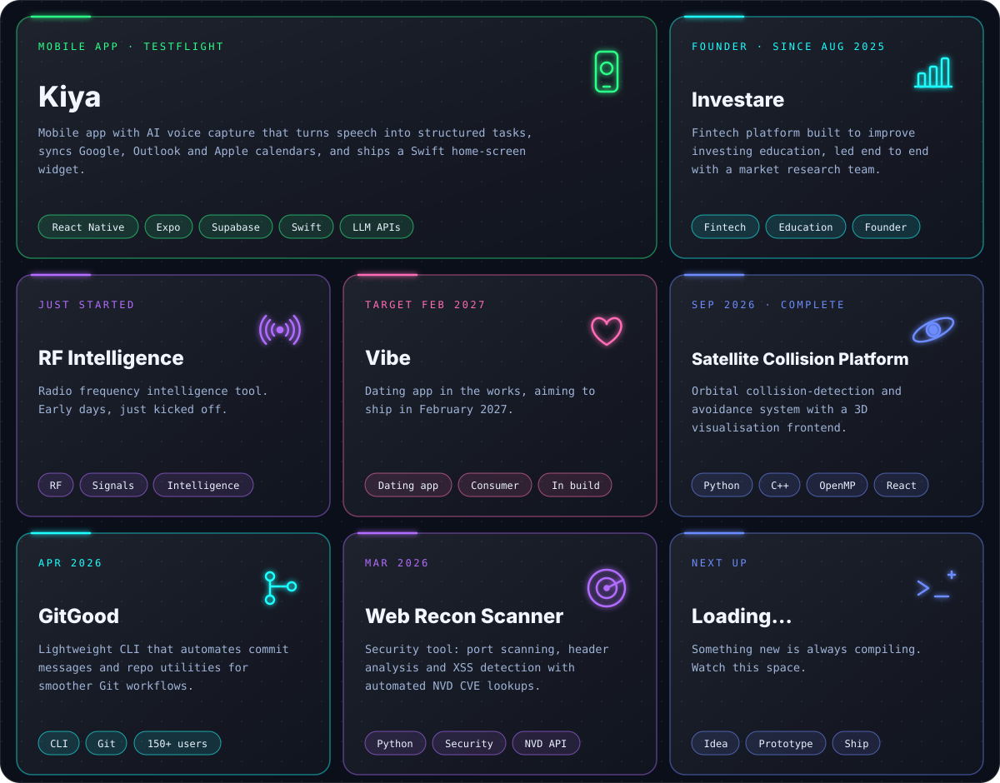
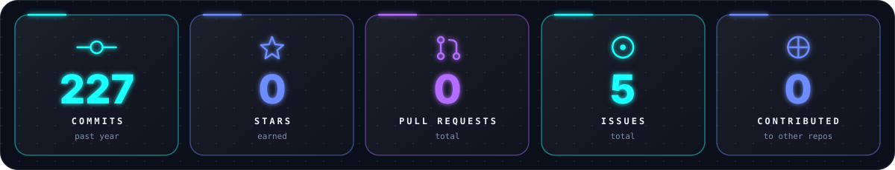

 

  

 

## 👋 About Me

  

 

## 🚀 Novalon Ltd

  
   
  Founder &amp; CEO of <b>Novalon</b>, a software development agency delivering web and mobile apps for clients. Also building <b>Investare</b>, a fintech platform for investing education. BSc Computer Science (Software Engineering) at <b>Royal Holloway</b>.

 

## ⚡ Skill Orbit

  

 

## 🧰 Toolkit

  

 

  
 

 

## 📈 GitHub Activity

 

<picture>
  <source media="(prefers-color-scheme: dark)" srcset="https://raw.githubusercontent.com/LouisB06/LouisB06/output/github-contribution-grid-snake-dark.svg" />
  <source media="(prefers-color-scheme: light)" srcset="https://raw.githubusercontent.com/LouisB06/LouisB06/output/github-contribution-grid-snake.svg" />
  
</picture>

 

## 🤝 Let's Connect

Always happy to talk data, projects, or interesting engineering problems.

  

