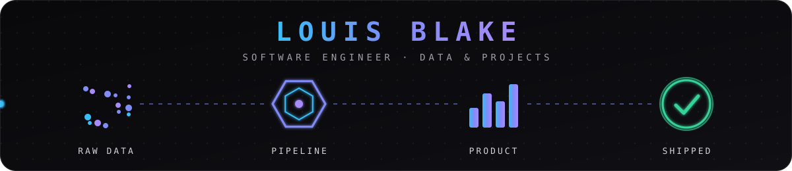
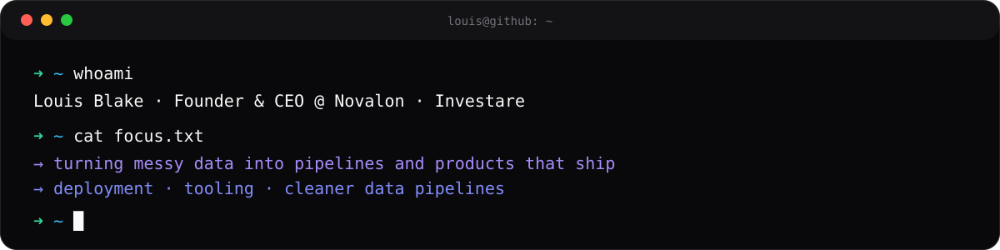

  

 

  

 

## ⚡ Skill Orbit

  

 

## 🧰 Toolkit

<table>
<tr>
<td align="center" width="33%">
<b>Languages</b>  

</td>
<td align="center" width="33%">
<b>Frameworks</b>  

</td>
<td align="center" width="33%">
<b>Tools &amp; Cloud</b>  

</td>
</tr>
</table>

 

## 📌 Pinned Projects

> Check out my pinned repos below ↓

 

## 📈 GitHub Activity

 

<picture>
  <source media="(prefers-color-scheme: dark)" srcset="https://raw.githubusercontent.com/LouisB06/LouisB06/output/github-contribution-grid-snake-dark.svg" />
  <source media="(prefers-color-scheme: light)" srcset="https://raw.githubusercontent.com/LouisB06/LouisB06/output/github-contribution-grid-snake.svg" />
  
</picture>

 

## 🤝 Let's Connect

Always happy to talk data, projects, or interesting engineering problems.

  

